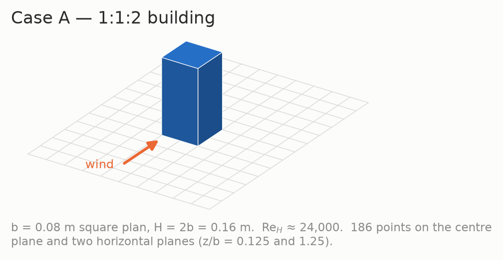
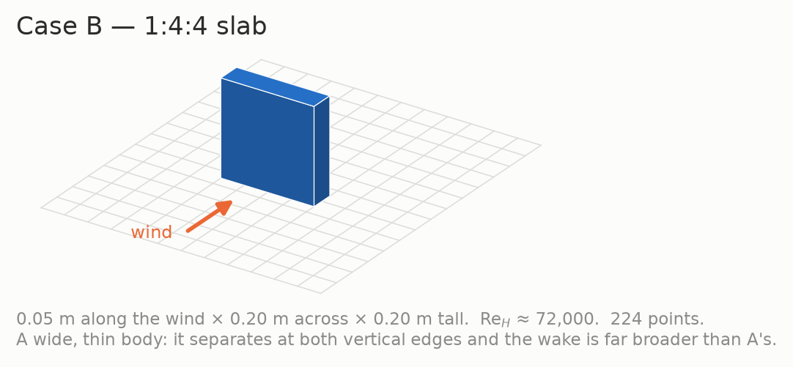
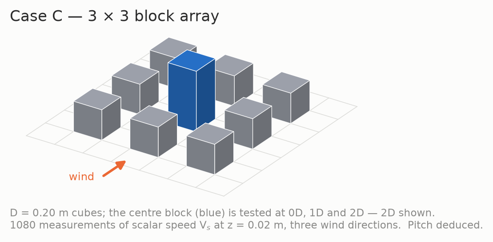
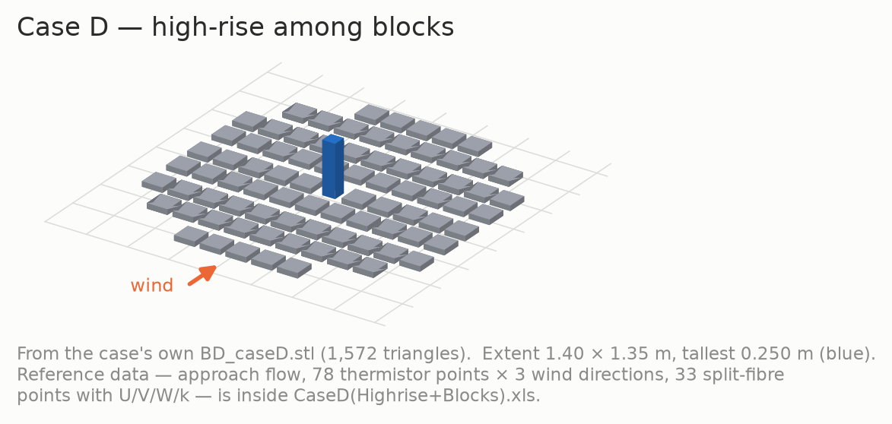
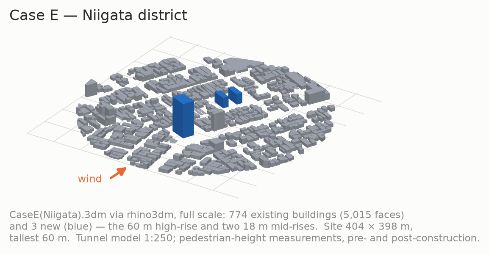
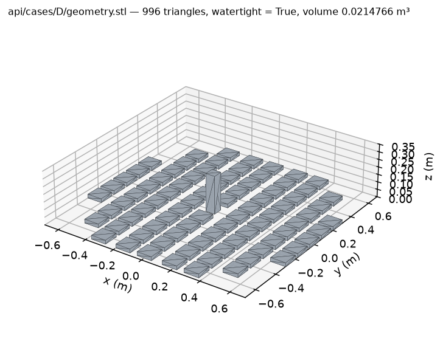
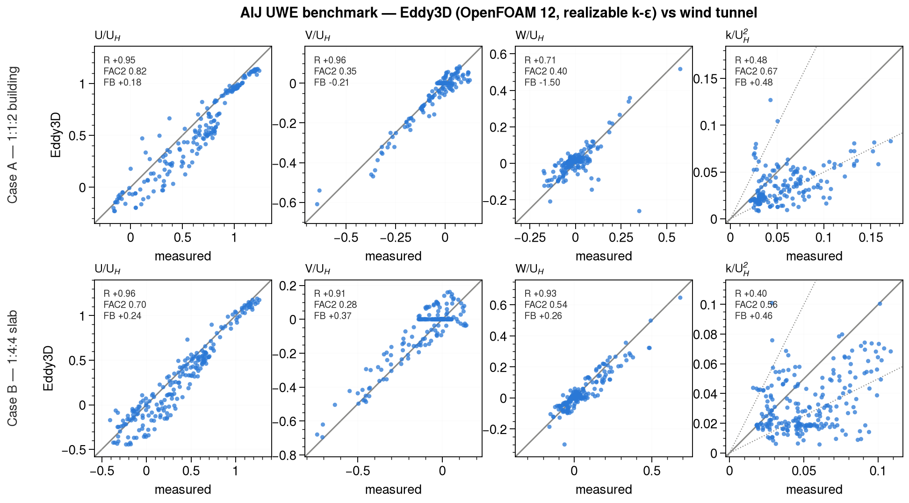

# CFD-Test-Cases-Architectural-Institute-of-Japan-AIJ

Wind-tunnel reference data from the **AIJ UWE** (Urban Wind Environment) benchmark, cleaned and
packaged case by case, together with Eddy3D's validation against it. The same material is served as a
website and as a static API that scripts and agents can query: cleaned measurement tables in SI units
and one frame per case, cleaned STL geometry in metres, and the validation scores.

<p>
<a href="validation/geometry/geom_caseA.png"></a>
<a href="validation/geometry/geom_caseB.png"></a>
<a href="validation/geometry/geom_caseC.png"></a>
<a href="validation/geometry/geom_caseD.png"></a>
<a href="validation/geometry/geom_caseE.png"></a>
</p>

**Site:** https://sustainableurbansystems.com/CFD-Test-Cases-Architectural-Institute-of-Japan-AIJ/ ·
**API:** [`/api/index.json`](https://sustainableurbansystems.com/CFD-Test-Cases-Architectural-Institute-of-Japan-AIJ/api/index.json) ·
[`/api/llms.txt`](https://sustainableurbansystems.com/CFD-Test-Cases-Architectural-Institute-of-Japan-AIJ/api/llms.txt) for agents ·
[OpenAPI](https://sustainableurbansystems.com/CFD-Test-Cases-Architectural-Institute-of-Japan-AIJ/api/openapi.json)
(the same files are in [`docs/api/`](docs/api/) on this branch)

| Case | Configuration | Measurements | Reference file |
|---|---|---|---|
| A | 1:1:2 building, b = 0.08 m, H = 0.16 m, Re_H ≈ 24,000 | 186 points, U/V/W/k | `Case_A_cleaned/RS-caseA.csv` |
| B | 1:4:4 slab, 0.05 × 0.20 × 0.20 m, Re_H ≈ 72,000 | 224 points, U/V/W/k | `Case_B_cleaned/RS_caseB.csv` |
| C | 3 × 3 block array, centre building at 0D / 1D / 2D | 1080 points, pedestrian height | `CaseC_cleaned/RS_caseC.csv` |
| D | High-rise among blocks | see `CaseD_cleaned/` | `CaseD(Highrise+Blocks).xls` |
| E | Niigata district, 1:250, pre/post high-rise | pedestrian height | `Case E_cleaned/CaseE(Niigata).xls` |

Sources and instrumentation are documented per case in each folder's `readme_case*.md`. The
accompanying papers are included here.

**Validation status: Cases A and B, OpenFOAM 12 (realizable k-ε).** Cases C–E and the other solvers are not
done yet — see "What is not validated yet" under *Validation method*. Nothing on this page is a claim about them.

---

<details>
<summary><b>Case A — 1:1:2 building</b> · 186 points, U/V/W/k · validated (OpenFOAM 12)</summary>

<p></p>

**Configuration.** A 1:1:2 (width : depth : height) prism, b = 0.08 m, H = 2b = 0.16 m, centred on the origin.
Re_H ≈ 24,000 on H and the approach wind speed at H, U_H = 4.491 m/s. Hot-wire split-fibre probes
(DANTEC 55R55 streamwise, 55R57 spanwise/vertical), 1000 Hz for 60 s per point, 500 Hz low-pass. Tunnel:
Technical Research Institute, Shimizu Corporation, Tokyo. Data collectors: Takeshi Ishihara (University of
Tokyo) and Kazuki Hibi (Numerical Flow Design); DOI
[10.5281/zenodo.15050147](https://doi.org/10.5281/zenodo.15050147).

**Reference data.** `Case_A_cleaned/RS-caseA.csv` — `No., x(m), y(m), z(m), U, V, W, u_rms, v_rms, w_rms, k`;
186 points on the vertical centre plane y/b = 0 and the horizontal planes z/b = 0.125 and 1.25. Coordinates are
**metres**, velocities m/s, turbulence as **rms** values. Approach flow in `AF_caseA.csv` (24 heights,
z = 0.005 … 0.6 m, with u/v/w rms and k). Point layouts: `MP-y_caseA.png`, `MP-z_caseA.png`. Frame: +x
streamwise, +y lateral (V positive toward +y), +z up; building spans x, y ∈ [−0.04, 0.04], z ∈ [0, 0.16];
points published on the y ≤ 0 half.

**Inflow fit** (log law over z = 0.02 … 2H): u\* = 0.343 m/s, z₀ = 0.668 mm, U_H measured 4.491 m/s, log-law
error +2.0 %.

**Validation (OpenFOAM 12, realizable k-ε).** Normalised by U_H; hit rate D = 0.25, W = 0.05 U_H.
Reattachment length **L_r/H = 1.49**.

| | U | V | W | k |
|---|---|---|---|---|
| **R** | +0.955 | +0.961 | +0.708 | +0.480 |
| **FAC2** | 0.817 | 0.349 | 0.398 | 0.667 |
| **FB** | +0.185 | −0.207 | −1.501 | +0.478 |
| **hit rate** | 0.586 | 0.892 | 0.801 | 0.177 |

The streamwise field is right (R ≈ 0.96, FAC2 0.82); k is under-predicted (FB +0.48, R 0.48); FAC2 on V and
W is low by construction because those components change sign; the W FB of −1.50 is an artefact of a near-zero
mean (mean measured W is ~0.01 m/s) — read R = +0.71 instead. Figures and the full reading are under
*Validation method* below.

**API.** [`cases/A.json`](docs/api/cases/A.json) · [`points.json`](docs/api/cases/A/points.json) /
[`points.csv`](docs/api/cases/A/points.csv) (variances uu = u_rms² so A and B share one column meaning) ·
[`geometry.stl`](docs/api/cases/A/geometry.stl) (1 box, 12 triangles) · [`validation.json`](docs/api/cases/A/validation.json)

</details>

<details>
<summary><b>Case B — 1:4:4 slab</b> · 224 points, U/V/W/k · validated (OpenFOAM 12)</summary>

<p></p>

**Configuration.** A 1:4:4 (depth : width : height) slab, 0.05 m deep (along the wind) × 0.20 m wide × 0.20 m
high, centred on the origin. Re_H ≈ 72,000 on H and U_H = 5.133 m/s. Hot-wire split-fibre probe, 100 Hz, 60 s per
point. Tunnel: Niigata Institute of Technology, Kashiwazaki. Data collector: Yoshihide Tominaga; DOI
[10.5281/zenodo.15401455](https://doi.org/10.5281/zenodo.15401455).

**Reference data.** `Case_B_cleaned/RS_caseB.csv` — `No., x[mm], y[mm], z[mm], U, V, W, <u'2>, <v'2>, <w'2>, k`;
224 points on the vertical centre plane y/H = 0 and the horizontal plane z/H = 1/16. Coordinates are
**millimetres**, velocities m/s, turbulence as **variances**. Approach flow in `AF_caseB.csv` (12 heights,
z = 0.005 … 1.0 m, with a 1/4-power fit column). Point layouts: `MP-y_caseB.png`, `MP-z_caseB.png`. Frame: +x
streamwise, +z up; slab spans x ∈ [−0.025, 0.025], y ∈ [−0.10, 0.10], z ∈ [0, 0.20]; points on the y ≤ 0 half.
**The published V is positive toward −y** (see *Data gotchas*); the API flips it so that A and B agree.

**Inflow fit** (log law over z = 0.02 … 2H): u\* = 0.399 m/s, z₀ = 0.882 mm, U_H measured 5.133 m/s, log-law
error +2.9 %.

**Validation (OpenFOAM 12, realizable k-ε).** Normalised by U_H; hit rate D = 0.25, W = 0.05 U_H.
Reattachment length **L_r/H = 3.27**.

| | U | V | W | k |
|---|---|---|---|---|
| **R** | +0.959 | +0.910 | +0.929 | +0.399 |
| **FAC2** | 0.701 | 0.281 | 0.536 | 0.562 |
| **FB** | +0.240 | +0.370 | +0.263 | +0.463 |
| **hit rate** | 0.562 | 0.612 | 0.808 | 0.223 |

The streamwise field is right (R ≈ 0.96, FAC2 0.70); k is under-predicted (FB +0.46, R 0.40). The flat row of
model V ≈ 0 in the agreement panel is the symmetry plane: a RANS solution is symmetric, so V ≡ 0 at y = 0, while
the tunnel measures small non-zero values.

**API.** [`cases/B.json`](docs/api/cases/B.json) · [`points.json`](docs/api/cases/B/points.json) /
[`points.csv`](docs/api/cases/B/points.csv) (metres, V sign unified) · [`geometry.stl`](docs/api/cases/B/geometry.stl)
(1 box) · [`validation.json`](docs/api/cases/B/validation.json)

</details>

<details>
<summary><b>Case C — 3 × 3 block array</b> · 1080 points, scalar speed at pedestrian height, 9 configurations · not validated yet</summary>

<p></p>

**Configuration.** Nine cubes of side D = 0.20 m on a 0.40 m pitch (street width = D), array footprint
1.0 × 1.0 m, centred on the origin. The centre building is tested at three heights — 0D (absent), 1D (0.2 m, as
the surroundings) and 2D (0.4 m) — and at three wind directions, 0°, 22.5° and 45°: **nine configurations**, all
sharing one 120-point set. Scalar wind speed Vs by thermistor anemometer (1 Hz, 30 s) at z = 0.02 m = 0.1 D
(2.0 m at the 1:100 scale Eddy3D would solve it at); approach flow by I-type hot wire (500 Hz, 30 s).
Re ≈ 52,000 on D; U_H = U(z = D) = 3.654 m/s. Tunnel: Fujita Corporation, Tokyo. Data collector: Yoshitami
Nonomura (Yamato University); DOI [10.5281/zenodo.15401791](https://doi.org/10.5281/zenodo.15401791).
The 0.40 m pitch is read from `MP-z-caseC.png` and Figure 3 of the data paper; the 120-point grid alone (49 absent
nodes of a 13 × 13 lattice = the nine footprints) bounds the pitch to (0.35, 0.40].

**Reference data.** `CaseC_cleaned/RS_caseC.csv` — `No., WD (deg.), CB, x (m), y (m), z (m), Vs (m/s),` (note
the trailing comma: an empty 8th column). 1080 rows = 3 WD × 3 CB × 120 points; coordinates **metres** (range
±0.30), z = 0.02 throughout; `CB` is **text** (`0D`/`1D`/`2D`). Point numbers run 4 … 132 with gaps at 34–37, 46,
55, 100–102 (1, 2, 3 are below the range). Approach flow in `AF_caseC.csv` (16 heights, z = 0.01 … 1.2 m, U and
u_rms). Frame: +x streamwise at WD = 0, confirmed three ways on the data (y → −y is a symmetry; the x ≤ −0.25 band
is faster than x ≥ +0.25 in every configuration; the regression slope of Vs is most negative within 0.8–4.3° of
+x). In the CSV's own frame WD rotates the wind from +x toward **−y** (the WD = 45° field mirrors about y = −x at
0.10–0.13 m/s, the experiment's repeatability, and not about y = +x, 0.5–0.8 m/s); Figure 3 of the data paper
draws the fan the other way — a y-sign flip that is invisible at WD = 0. This release keeps the CSV frame.

**Inflow fit** (log law, κ = 0.41, on `AF_caseC.csv`): over z = 0.02 … 0.40 m, u\* = 0.25598 m/s,
z₀ = 0.4797 mm (U_D +3.08 %, but U(0.02) −4.31 %, so the scored ratio is biased −7.17 %); over z = 0.01 … 0.40 m,
u\* = 0.22853 m/s, z₀ = 0.2362 mm (+1.65 % at 0.02 m, +2.83 % at D, ratio bias −1.15 %). The profile's fitted
power-law exponent is 0.190 over that range (the paper's 0.28 is for the full boundary layer); turbulence
intensity at z = D is 0.219.

**What a validation will have to handle.** Vs is an omnidirectional *scalar* speed — no Vs in the 1080 rows is
below 0.13 U_H, a floor a RANS |U| goes well under in a sheltered street — so the comparison is the bracket
|U| ≤ Vs ≤ √(|U|² + 2k), not one number. 24 of the 120 points sit exactly on a building face plane (|x| or
|y| = 0.30) in the gap between blocks. The structure to reproduce at WD = 0: the 2D centre block roughly doubles
the windward street's pedestrian speed over 0D (mean Vs 2.398 vs 1.172 m/s) while the leeward street moves little
(1.315 vs 1.090). Repeatability floor from the mirror pairs: mean |ΔVs| 0.088–0.137 m/s (0.024–0.038 U_H).

**API.** [`cases/C.json`](docs/api/cases/C.json) · [`points.json`](docs/api/cases/C/points.json) /
[`points.csv`](docs/api/cases/C/points.csv) · [`geometry.json`](docs/api/cases/C/geometry.json) (box lists) ·
[`geometry.stl`](docs/api/cases/C/geometry.stl) (2D) / [`geometry_1D.stl`](docs/api/cases/C/geometry_1D.stl) /
[`geometry_0D.stl`](docs/api/cases/C/geometry_0D.stl) · [`validation.json`](docs/api/cases/C/validation.json) (empty)

</details>

<details>
<summary><b>Case D — high-rise among city blocks</b> · 78 points × 3 directions (thermistor) + 33 points U/V/W/k · not validated yet</summary>

<p></p>

**Configuration.** One 1:1:4 tower, 0.25H × 0.25H × H = 62.5 × 62.5 × 250 mm, replacing the centre block of a
regular array of 82 blocks of 0.4H × 0.4H × 0.1H = 100 × 100 × 25 mm; roads 0.1H / 0.2H / 0.3H = 25 / 50 / 75 mm
(9 columns in x on an alternating 175 / 150 mm pitch, 11 rows in y on 125 mm); the array is 1400 × 1350 mm with
its corners cut by the turntable circle. Scale 1:400 (H = 100 m full scale); U_H = 6.65 m/s at H = 250 mm;
Re ≈ 1.1 × 10⁵. All measurements at z = 5 mm (2 m full scale): a thermistor anemometer at 78 points for WD = 0,
22.5 and 45° (66 measured per direction — the 12 points in the band around the tower are unmeasured) and a
split-fibre probe at 33 points for WD = 0 with U, V, W, variances and k. Source: Kikumoto et al. (2026) §3.4;
Case D ships here without its Zenodo readme.

**Reference data.** Everything is inside `CaseD_cleaned/CaseD(Highrise+Blocks).xls`, a genuine OLE2/BIFF8
workbook (xlrd 2.x reads it; openpyxl cannot): sheets `Geometry&Points`, `Inflow` (13 heights, z = 5 … 1200 mm,
U and k), `Results (Exp_S)` (split fibre) and `Results (Exp_T)` (thermistor; unmeasured cells are `-`).
Coordinates are **millimetres**; the API serves metres. Frame: +x streamwise at WD = 0 (the 0° thermistor field
is exactly y-mirror symmetric — 33 exact pairs, so only 33 of the 66 values are independent; the split-fibre U is
positive at the stream-like points and negative in the tower's windward horseshoe). The rotation sense for 22.5°
and 45° is **+x toward +y, read from Figure 4 of the data paper** — the array is exactly y-mirror symmetric, so
the data cannot settle it. `BD_caseD.stl` is the geometry: 83 closed shells in model metres, but **dirty** (1572
facets, 576 duplicates, all 83 roofs wound inward, signed volume 0.011159 m³ against the true 0.021477 m³); the
API's `geometry.stl` is rebuilt from the shells' boxes (996 facets, watertight, 0.021477 m³). The DXF adds nothing
over the STL. `Eddy3D vs AIJ.xlsx` is a prior attempt that scores R = +0.096 against the thermistor — a frame or
geometry error, not a validation.

**Inflow fit** (log law, κ = 0.41, two windows because the measurement plane z/H = 0.02 sits below the A/B
window): over z = 0.005 … 2H, u\* = 0.3418 m/s, z₀ = 0.0859 mm (U at 5 mm −11.2 %, profile rms 7.9 %, inlet
k 0.3895 m²/s², 26–48 % below the tunnel's); over z = 0.02 … 2H, u\* = 0.4240 m/s, z₀ = 0.4033 mm (U at 5 mm
−30.0 %, inlet k 0.5991). Fitted power-law exponent 0.189 (the paper states 0.25). A log-law inlet cannot be
right at both the measurement plane and the upper profile.

**What a validation will have to handle.** Case D is the only case where both instruments overlap: over the 33
shared points the thermistor reads 1.342× |U| (ratio of means; 1.50 as the mean of ratios), and
√(|U|² + 2k) from the split-fibre data matches the thermistor to FB +0.058, R 0.947, FAC2 1.000 where |U| alone
gives FB +0.292, R 0.872. That correction is 40 % of the scored quantity's square, fed by an inlet whose k is
half the tunnel's — so a low bias should be expected and attributed, not treated as a surprise.

**API.** [`cases/D.json`](docs/api/cases/D.json) · [`points.json`](docs/api/cases/D/points.json) /
[`points.csv`](docs/api/cases/D/points.csv) (267 rows: 234 thermistor + 33 split fibre, `instrument` column) ·
[`geometry.json`](docs/api/cases/D/geometry.json) (83 boxes) · [`geometry.stl`](docs/api/cases/D/geometry.stl) ·
[`validation.json`](docs/api/cases/D/validation.json) (empty)

<p></p>

</details>

<details>
<summary><b>Case E — Niigata district</b> · 80 points × 16 directions × before/after, velocity ratio · not validated yet</summary>

<p></p>

**Configuration.** A real district in Niigata City near the Shinano River — dense low-rise stock (median top 6 m,
max 30 m) — at 1:250, measured before and after the construction of a 60 m high-rise (A) and two 18 m mid-rises
(B, C). Thermistor anemometer (100 Hz, 60 s per point, mean scalar speed) at 80 points at z = 2 m full scale
(0.008 m model) for 16 wind directions: 80 × 16 × 2 = 2560 values. Re ≈ 17,000. The measured quantity is a
**velocity ratio**: scalar speed at 2 m / inflow velocity at 15.9 m, the Niigata meteorological station height.
Tunnel: Niigata Institute of Technology; data collector: Yoshihide Tominaga; DOI
[10.5281/zenodo.15429017](https://doi.org/10.5281/zenodo.15429017).

**Reference data.** The readme describes `AF_caseE.csv`, `RS_caseE.csv` and `BD_caseE.stl`, but this repository
holds only `CaseE(Niigata).3dm`, `CaseE(Niigata).ghx`, `CaseE(Niigata).xls`, `MP_caseE.png` and a prior
`Eddy3D vs AIJ.xlsx`. The workbook holds everything: `Geometry&Points` (80 points, "m in actual scale, origin at
the centre of the reproducing area"), `Inflow` (z/ZR, U/UR, k/UR² with ZR = 1 m model = 250 m, UR = 7.8 m/s, and
ε = Cμ^0.5 k dU/dz, Cμ = 0.09) and `Results (Before/After Construction)` (80 × 16 each, columns N … NNW).
The 3dm is **full-scale metres** (`MP_caseE.png` is drawn at model scale, ±0.8 m): layer `buildings` holds the
existing stock (5,015 meshes, the three sites already cleared), `buildings_new_construction` exactly the three new
prisms; the map plate on the Japanese-named general layer, the flat terrain plates and the `probes` layer are not
buildings. Frame: +x east, +y north (compass rose in `MP_caseE.png`); compass names are the direction the wind
comes **from**. All 80 points fall in open space (min 0.83 m from a building edge); rotating the cloud by 10°
puts 18 of them inside buildings, so the frame is verified. Do not take coordinates from the `probes` layer (median
2.31 m, max 21 m off).

**Normalisation and resolution.** All 2560 ratios are integer multiples of 0.0198204, which pins the normalising
velocity at U(15.9 m) = 0.504531 × UR = 3.935 m/s (linear interpolation of the published profile gives 3.929) and
the data's resolution at ±0.0099 — 3.1 % of the median and ~10 % at the lowest points. The prior `Eddy3D vs
AIJ.xlsx` (after construction, wind from N) is low by a least-squares factor of 2.048, i.e. it divided by the wrong
reference; rescaled, its FAC2 goes 0.338 → 0.863 with R unchanged at 0.661.

**Inflow.** A log law does not fit this 250 m boundary layer (5.3–9.4 % max error over the relevant heights, and
every fit overshoots U(15.9 m) by 4–7 %); power-law exponents are 0.158 (ground … 60 m) and 0.201 (whole profile).
A tabulated inlet is the honest choice. The construction signal is large: mean (ac − bc) = +0.097, largest for
SW (mean |Δ| 0.2155) and smallest for SSE (0.093).

**API.** [`cases/E.json`](docs/api/cases/E.json) · [`points.json`](docs/api/cases/E/points.json) /
[`points.csv`](docs/api/cases/E/points.csv) (2560 rows, `config` bc/ac, `wind_direction` N … NNW) ·
[`geometry.stl`](docs/api/cases/E/geometry.stl) (after construction, 8436 triangles) /
[`geometry_bc.stl`](docs/api/cases/E/geometry_bc.stl) (before, 8400), both re-oriented outward ·
[`validation.json`](docs/api/cases/E/validation.json) (empty)

</details>

---

<details>
<summary><b>Validation method</b> · how Eddy3D is scored, the figures, what is not validated yet</summary>

Each case is solved through Eddy3D's production case writer (`build-case → run → probe`), not a
hand-built OpenFOAM case, so what is validated is what a user gets. The probe sits at **exactly the
tunnel's own measurement coordinates**, so no interpolation enters the comparison.

### Does the model agree?



Measured against modelled for each quantity, with the 1:1 line and, where the quantity does not
change sign, the factor-of-two band.

| | A — U | A — V | A — W | A — k | B — U | B — V | B — W | B — k |
|---|---|---|---|---|---|---|---|---|
| **R** | +0.955 | +0.961 | +0.708 | +0.480 | +0.959 | +0.910 | +0.929 | +0.399 |
| **FAC2** | 0.817 | 0.349 | 0.398 | 0.667 | 0.701 | 0.281 | 0.536 | 0.562 |
| **FB** | +0.185 | −0.207 | −1.501 | +0.478 | +0.240 | +0.370 | +0.263 | +0.463 |
| **hit rate** | 0.586 | 0.892 | 0.801 | 0.177 | 0.562 | 0.612 | 0.808 | 0.223 |

Normalised by U_H throughout, the benchmark's own convention. Hit rate uses D = 0.25, W = 0.05 U_H.
Reattachment length behind the building: **L_r/H = 1.49** (Case A), **3.27** (Case B).

Reading these honestly:

- **The streamwise field is right** — R ≈ 0.96 in both cases, FAC2 0.82 / 0.70.
- **k is under-predicted in both** (FB ≈ +0.47, R ≈ 0.4), the familiar realizable k-ε behaviour and
  consistent with what Eddy3D already records for AIJ Case H.
- **FAC2 on V and W is low by construction, not by failure.** Those components change sign, so
  factor-of-two agreement is a harsh measure near zero; R and hit rate are the meaningful columns
  there. The flat row of model V ≈ 0 in Case B's panel is the symmetry plane: a RANS solution is
  symmetric, so V ≡ 0 at y = 0, while the tunnel measures small non-zero values.
- **Case A's W FB of −1.50 and its NMSE are artefacts of a near-zero mean** (mean measured W is
  ~0.01 m/s), not a blow-up. Read R = +0.71 instead.

### Where does it agree?


Vertical profiles of U/U_H on the centre plane at the first three measured stations behind the
building, offset per station. The model follows the measured profile closely above roof height and
in the recovering wake; the near-ground deficit immediately behind the building is where the
closure does least well.

### Metrics

R is Pearson's correlation; FAC2 the fraction of points within a factor of two; FB the fractional bias
2(ō − p̄)/(ō + p̄), positive when the model is low; hit rate the fraction within D = 0.25 relative or
W = 0.05 U_H absolute. NMSE, NAD, MG and VG are in `validation/results/*.json` and the API's `validation.json`.

### Inflow

Fitted to each case's own approach-flow file over z = 0.02 … 2H, rather than assumed:

| Case | u\* (m/s) | z₀ (mm) | U_H measured (m/s) | log-law error |
|---|---|---|---|---|
| A | 0.343 | 0.668 | 4.491 | +2.0 % |
| B | 0.399 | 0.882 | 5.133 | +2.9 % |

### Reproducing the figures

`validation/plot_aij.py` (UltraPlot) builds both figures from the solved studies and the reference
CSVs. The Eddy3D fixtures are `TestAijCaseAContainerE2E` and `TestAijCaseBContainerE2E`. Their
`results.json` files are snapshotted in `validation/results/` and served unchanged by the API.

### What is not validated yet

| | A | B | C | D | E |
|---|---|---|---|---|---|
| OpenFOAM | ✅ | ✅ | — | — | — |
| OpenLB | — | — | — | — | — |
| FluidX3D | — | — | — | — | — |
| ML surrogate | n/a | n/a | — | — | — |

Cases C–E need their geometry built (C is parametric, D ships an STL, E is a Rhino model of a real district) —
the API now serves cleaned STLs for all three, which is the first step, not the validation. The ML surrogate
predicts **pedestrian-height** wind, which Cases A and B do not measure, so there is nothing to compare for those
two — marked n/a rather than pending.

</details>

<details>
<summary><b>Data gotchas</b> · what in the published files silently corrupts a comparison</summary>

Both of the first two were found by scoring the files rather than reading them, and both would quietly corrupt a
comparison:

1. **Cases A and B report the lateral velocity V with opposite sign conventions.** Just outside the
   windward side face the flow must deflect away from the centreline — toward −y on the y < 0 flank.
   Case A measures **V = −2.893 m/s** at (−0.040, −0.050, 0.010) with its edge at y = −0.04; Case B
   measures **V = +3.630 m/s** at (−0.025, −0.110, 0.013) with its edge at y = −0.100. Same flow
   feature, opposite sign, so **Case B's V is positive toward −y**. Scored without correcting for
   this, Case B's V comes out at R = −0.910 against an R = +0.959 streamwise control on the same
   points — an anti-correlation no turbulence closure produces.
2. **Case B's coordinates are millimetres** (`x[mm]`) while its velocities are m/s; Case A's are
   metres. Read as metres, every probe lands 1000× too far out.

Case geometry was taken from each case's own measurement-point drawing (`MP-z_case*.png`), not
inferred from the CSV extents: both buildings are centred on the origin, with points published on
the y ≤ 0 half by the tunnel's symmetry convention.

The rest, measured while scoping C–E (each case's section above carries the detail):

3. **Scalar vs vector speed.** C, D and E measure with thermistors — an omnidirectional *scalar* mean speed. A RANS
   |U| is low against it by construction; Case D's overlapping instruments put the ratio at 1.34 (ratio of means).
   Compare the bracket |U| ≤ Vs ≤ √(|U|² + 2k).
4. **Case C's `CB` column is text** and its header has a trailing comma; its 1080 rows are nine configurations.
   Its wind-direction rotation sense differs by a y-sign flip between the CSV (toward −y) and the paper's figure.
5. **Case D's STL is dirty** (duplicates, inward roofs); its data is in a BIFF8 `.xls` in millimetres with `-` for
   unmeasured; its 22.5°/45° rotation sense rests on a figure, because the array's y-symmetry makes it undecidable
   from the data.
6. **Case E's velocity ratio is normalised by U(15.9 m) = 3.935 m/s**, not U_H or UR; the data is quantised at
   0.0198; the cleaned CSV/STL the readme names are absent (everything is in the `.xls` and the full-scale `.3dm`);
   the `probes` layer is not the measurement coordinates.

The cleaned tables served by the API apply the unit, sign and frame corrections; the raw files do not.

</details>

<details>
<summary><b>API</b> · static endpoints for scripts and agents</summary>

Every endpoint is a file under `docs/api/`, generated by `scripts/build_api.py` and served by GitHub Pages at
`https://sustainableurbansystems.com/CFD-Test-Cases-Architectural-Institute-of-Japan-AIJ/api/…` (and raw from this
repository at `https://raw.githubusercontent.com/SustainableUrbanSystemsLab/CFD-Test-Cases-Architectural-Institute-of-Japan-AIJ/main/docs/api/…`).
Plain GET; every JSON file carries `schema_version`, `generated_from` (git commit of the data) and `licence`.

| Endpoint | Returns |
|---|---|
| `GET /api/index.json` | every endpoint, versions, licence, how to cite |
| `GET /api/cases.json` | the five cases: id, title, configuration facts, units, frame, counts, which engines are validated, links |
| `GET /api/cases/{id}.json` | one case in full: geometry files, inflow fit + approach-flow profile, configurations (C's 9, E's pre/post), reference-point summary, gotchas |
| `GET /api/cases/{id}/points.json` · `.csv` | the cleaned measurement table, SI units, one frame, null for unmeasured |
| `GET /api/cases/{id}/geometry.stl` · `geometry.json` | cleaned STL in metres, origin at the building/array centre, +x along the wind at WD = 0 (A–D; E keeps its geographic frame); box lists where the geometry is boxes |
| `GET /api/cases/{id}/validation.json` | scores per engine (empty list where none has been run) with figure URLs |
| `GET /api/openapi.json` | OpenAPI 3.1 description |
| `GET /api/llms.txt` | the agent entry point, plain text |

```bash
BASE=https://sustainableurbansystems.com/CFD-Test-Cases-Architectural-Institute-of-Japan-AIJ/api
curl -s $BASE/cases.json | jq '.cases[] | {id, counts, engines}'
curl -s $BASE/cases/B/points.json | jq '.points[0]'
curl -s -o caseD.stl $BASE/cases/D/geometry.stl
```

```python
import json, urllib.request
BASE = "https://sustainableurbansystems.com/CFD-Test-Cases-Architectural-Institute-of-Japan-AIJ/api"
case = json.load(urllib.request.urlopen(f"{BASE}/cases/B.json"))
print(case["frame"], case["units"])                       # read the frame before the numbers
pts = json.load(urllib.request.urlopen(f"{BASE}/cases/B/points.json"))["points"]
```

An agent should fetch `index.json`, then `cases.json`, then the case; points are SI, geometry is metres, an empty
`results` list in `validation.json` means no validation exists — and cite the AIJ benchmark. Full examples on the
site's API page and in `docs/api/llms.txt`.

Regenerate with `pip install xlrd rhino3dm matplotlib && python scripts/build_api.py`. The point tables come from
`clean/` when `clean/manifest.json` names them and from the raw case folders otherwise (`points_source` in each
`points.json` says which); validation scores come from `validation/results/`.

</details>

<details>
<summary><b>Cite</b> · licence and attribution</summary>

The measurement data belongs to its collectors and distributors, named per case: Takeshi Ishihara
and Kazuki Hibi (Case A), with the dataset edited and distributed by Yoshihide Tominaga, Hideki
Kikumoto and Tsubasa Okaze. Cite the AIJ UWE benchmark and the accompanying papers when using it.

- Kikumoto, H., Tominaga, Y., Okaze, T. et al. (2026). *Comprehensive Experimental Database for Validating CFD
  Simulations in Urban Environments.* Japan Architectural Review 9(1), e70083.
- Tominaga, Y., Mochida, A., Yoshie, R., Kataoka, H., Nozu, T., Yoshikawa, M., Shirasawa, T. (2008). *AIJ guidelines
  for practical applications of CFD to pedestrian wind environment around buildings.* JWEIA 96, 1749–1761.
  https://doi.org/10.1016/j.jweia.2008.02.058
- Per case: A — Meng & Hibi (1998), JAWE 76, 55–64, [zenodo.15050147](https://doi.org/10.5281/zenodo.15050147);
  B — Miyazaki & Tominaga (2003), [zenodo.15401455](https://doi.org/10.5281/zenodo.15401455);
  C — Nonomura et al. (2003), [zenodo.15401791](https://doi.org/10.5281/zenodo.15401791);
  D — Kikumoto et al. (2026) §3.4; E — [zenodo.15429017](https://doi.org/10.5281/zenodo.15429017).
- Licence: CC BY 4.0.

</details>
